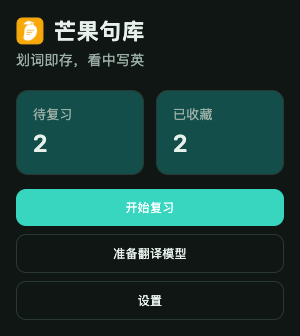
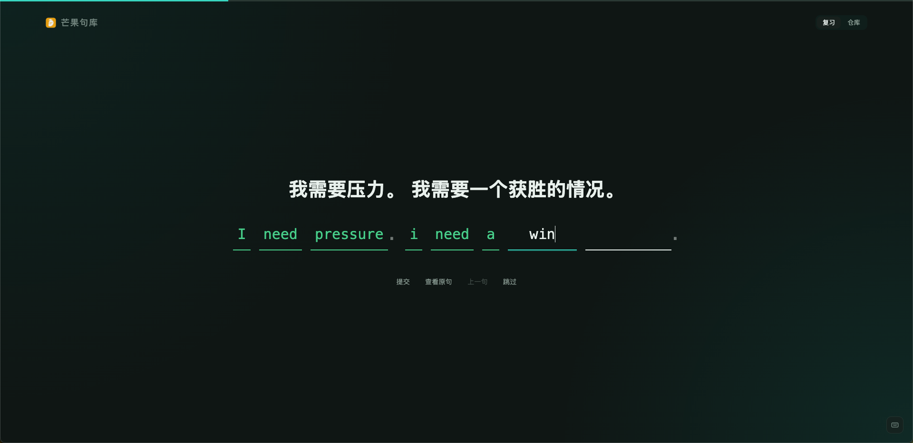
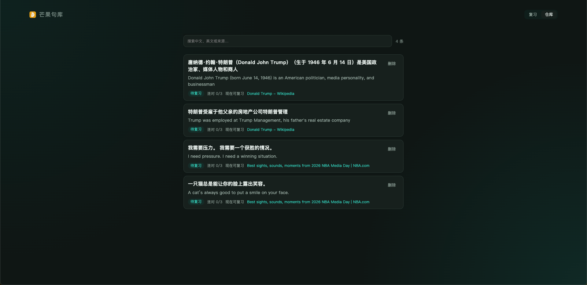

# 芒果句库 MangoSentences

划词即存，看中写英。

在浏览英文网页时划词翻译、一键收藏句子，再用「看中文、默写英文」的方式复习。翻译在本地完成，无需账号，数据只存在你的电脑上。

**需要 Chrome 138 及以上桌面版。**

## 下载

[芒果句库-1.0.1-chrome.zip](releases/芒果句库-1.0.1-chrome.zip)

## 安装

1. 下载上方压缩包，解压到任意文件夹（解压后应能看到 `manifest.json`）。
2. 打开 Chrome，地址栏输入 `chrome://extensions` 并回车。
3. 打开右上角「开发者模式」。
4. 点击「加载已解压的扩展程序」，选择刚才解压出的那个文件夹。
5. 安装成功后，地址栏右侧会出现芒果句库图标。

## 截图

### 地址栏弹窗

快速进入复习、句库与设置。

### 复习页面

看中文填英文，按词实时对错反馈，配合进度条完成每日复习。

### 句子仓库

搜索、浏览已收藏句子，查看复习状态，支持删除。

## 功能

- 划词翻译：选中英文即可看到中文
- 一键保存：收藏原句、译文和来源页面；也可右键翻译并保存
- 填空复习：按单词默写，实时对错反馈，支持跳过、重做、上一句
- 句子仓库：检索与管理已收藏句子
- 设置：导入 / 导出备份、每日上限、自动保存等
- 隐私优先：数据仅存本机，不上云
